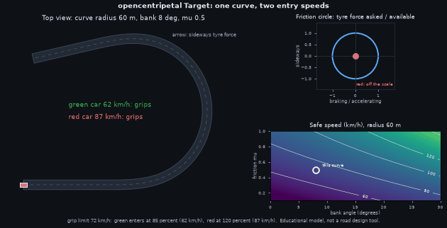
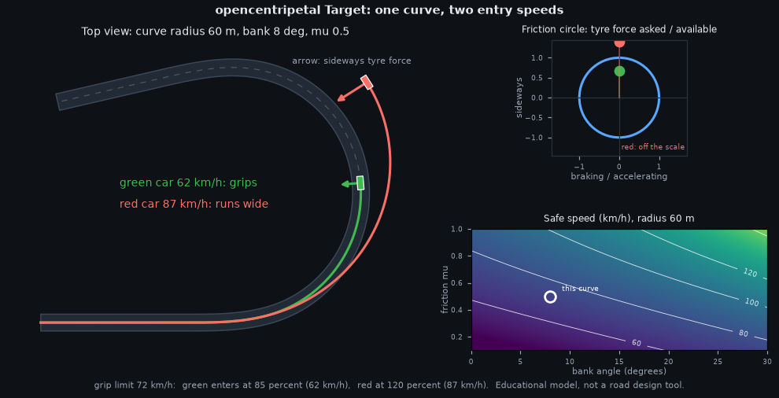
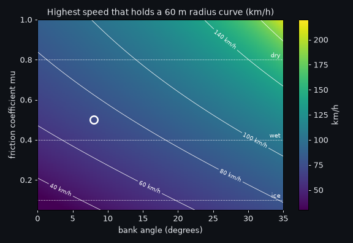
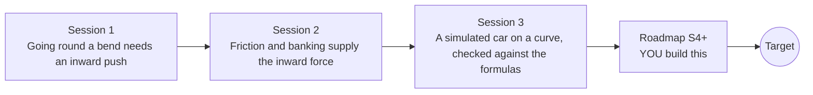

# opencentripetal

[](https://github.com/KrunalPanchal1995/opencentripetal/actions/workflows/ci.yml)   [](https://colab.research.google.com/github/KrunalPanchal1995/opencentripetal/blob/main/sessions/session-01/lesson.ipynb) [](https://krunalpanchal1995.github.io/opencentripetal/)

**Design a banked curve that grips at speed, in three sessions.**

opencentripetal teaches circular motion and centripetal force through cars on curves: friction, banking and a friction-circle simulation, using only Python and a browser.

- **Start from zero.** Session 1 needs only school arithmetic: one formula, a = v^2 / r.
- **See it move.** Every session ships a slider app that runs in the browser, with labelled graphs.
- **Know you got it right.** The simulation is validated against the analytic limits, and each session ends with a checkpoint that prints PASS or FAIL.
- **Build the missing half.** The repo stops at Session 3 on purpose; the roadmap shows the path to the Target.

[Target](#the-target) · [Who is this for](#who-is-this-for) · [Quick start](#quick-start) · [Sessions](#sessions) · [Roadmap](#roadmap) · [Contribute](#contribute) · [Explainer PDF](docs/explainer.pdf)

> **This repo is incomplete on purpose.** Sessions 1 to 3 are here and fully working. The finished Target below is a preview of what the community can build next. We show you the path, not the code. Sessions 4 and up are yours.

## The Target

A top-down animation of a curve with a straight, a smooth transition and a banked arc. A green car enters at 85 percent of the grip limit and holds the lane; a red car enters at 120 percent and slides wide, with the friction circle showing its demand leaving the circle at the same moment. A map on the right shows the safe speed for every combination of bank angle and road friction. Your goal over the coming sessions: build this yourself, then add transition spirals, weight transfer and rollover.



*Target: a safe car and a car entering too fast, with the friction circle and the safe-speed map*



*Target, one frame: the red car has run wide and its demand is outside the friction circle*



*Safe speed over bank angle and road friction for a curve of radius 60 m*

Try it live:

- [Math Visual Studio: Newton's laws of motion (Atlas S36)](https://krunalpanchal1995.github.io/studio/#atlas?ch=S36&ex=1)
- [Math Visual Studio: free-body diagrams (Atlas S37)](https://krunalpanchal1995.github.io/studio/#atlas?ch=S37&ex=1)

How the Target was made is shown only as a path in [promo/roadmap.md](promo/roadmap.md).

## Who is this for
**secondary school to diploma / undergraduate (levels 3-5).** Topic area: Physics and the Science of Motion.

Prerequisites:

- Multiplication, division and square roots; the idea of speed in m/s.
- Sine, cosine and tangent of an angle for Session 2 (explained where used).
- Python 3.10 or newer; if `python --version` works, you are ready. PRIMER.md explains the rest.
- No prior GitHub or physics-simulation experience is needed.

New to Python? Read [PRIMER.md](PRIMER.md) first (10 minutes).

## Quick start

No installation knowledge needed. You need [Git](https://git-scm.com/downloads) and [Python 3.10+](https://www.python.org/downloads/) (Windows: tick "Add Python to PATH"). On Mac and Linux type `python3` wherever this page says `python`.

```bash
git clone https://github.com/KrunalPanchal1995/opencentripetal.git
cd opencentripetal
python start.py 1
```

`start.py` creates a private environment, installs what is needed and runs Session 1 with its checkpoint. Next: `python start.py 2`, `python start.py 3`, or `python start.py test` to check everything. Only a checkpoint: `python start.py check 1`.

Five lines turn the idea of Session 2 into a result (they work as they are): Save it as `try.py` and run it with `python start.py run try.py` (this uses the private environment, where NumPy is installed):

```python
import numpy as np
g, r = 9.81, 100.0                      # gravity (m/s^2), curve radius (m)
v = 80 / 3.6                             # 80 km/h in m/s
print(round(np.degrees(np.arctan(v**2 / (g * r))), 1))   # -> 26.7  ideal bank angle (degrees)
print(round(3.6 * np.sqrt(0.4 * g * r), 1))              # -> 71.3  wet flat-road limit (km/h)
```

Every session also opens in your browser with sliders (no install): [live apps](https://krunalpanchal1995.github.io/opencentripetal/). Or use the Colab badge above for the notebook.

## Sessions

| # | Session | Model level | Time | Live app |
|---|---|---|---|---|
| 1 | [Going round a bend needs an inward push](sessions/session-01/README.md) | Level 1: conceptual interactive model | 60 min | [open](https://krunalpanchal1995.github.io/opencentripetal/session-01/) |
| 2 | [Friction and banking supply the inward force](sessions/session-02/README.md) | Level 2: mathematical engineering model | 75 min | [open](https://krunalpanchal1995.github.io/opencentripetal/session-02/) |
| 3 | [A simulated car on a curve, checked against the formulas](sessions/session-03/README.md) | Level 3: simulation and validation | 90 min | [open](https://krunalpanchal1995.github.io/opencentripetal/session-03/) |

Each session follows the same six steps: A real-world problem, B concept and theory, C visual explanation, D interactive simulation, E worked example and experiment, F assessment and design challenge. Each ends with `checkpoint.py`, which prints `PASS` or `FAIL` against reference numbers. Session 3 also contains the real-world mini-project: **Set the speed limit sign for a curve**.

## Architecture



| Folder or file | What is inside |
|---|---|
| `sessions/` | three sessions: README (A-F), `lesson.py`, notebook, live app, exercises, activity sheet, checkpoint |
| `promo/` | the Target: media, live links, and the roadmap (path only) |
| `docs/` | `explainer.tex` and the built `explainer.pdf` |
| `tests/` | runs every lesson and checkpoint headless |
| `start.py` | one command to set up and run anything |
| `QUALITY.md`, `RUBRIC.md` | the quality checklist and the scoring rubric |
| `.github/` | CI, PDF build, Pages deploy, issue and PR templates |

## Roadmap

| Milestone | What you will build | Difficulty |
|---|---|---|
| Session 4: Transition spiral into the curve | A path made of a straight, a clothoid and an arc, followed by the Session 3 car. | intermediate |
| Session 5: Weight transfer between left and right wheels | A car with centre of gravity height, track width and four tyre loads. | intermediate |
| Session 6: Rollover before sliding | A rollover check added to the friction-circle limit. | advanced |
| Session 7: Plan the speed round a whole circuit | A speed planner for a stadium circuit of two 100 m straights and two half circles of radius 30 m. | advanced |
| Session 8: Measure mu and compare with a turntable | A short lab report with a measured mu, a predicted slip speed and a measured slip speed. | intermediate |

Full detail with a checkpoint per milestone: [promo/roadmap.md](promo/roadmap.md).

## Contribute
New to GitHub? Read [CONTRIBUTING.md](CONTRIBUTING.md); it starts from zero. Pick an issue labelled `good first issue`. Translations into Hindi, Telugu, Tamil and Malayalam are welcome.

<details>
<summary>Development</summary>

```bash
python start.py test        # runs every lesson and checkpoint
```
Lessons use `# %%` cell markers so they open as notebooks in VS Code. See [QUALITY.md](QUALITY.md) for the standard every session meets.
</details>

## License
MIT. See [LICENSE](LICENSE). Media in `promo/media` is (c) Krunal Panchal, CC BY 4.0.

## Acknowledgments
Part of the [PAN IIT OSS](https://hellofoss.tech-iitb.org/projects) open-source teaching collection, modelled on the structure of [openspline](https://github.com/openspline/openspline). Built on ideas from the Math Visual Studio at https://krunalpanchal1995.github.io/studio/.
