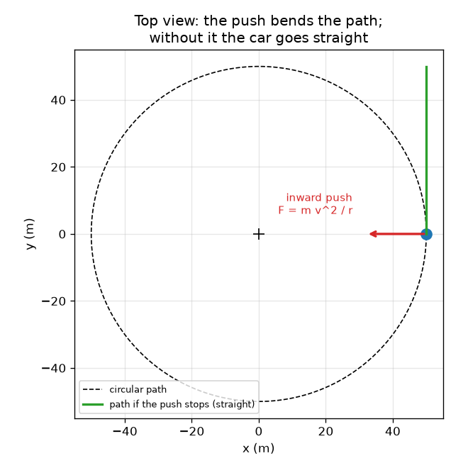
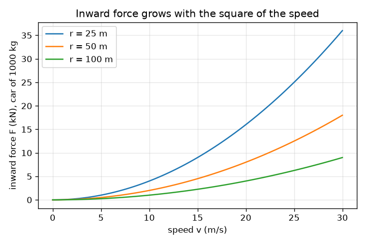

# Session 1: Going round a bend needs an inward push

*Level 1 (conceptual interactive model) · about 60 minutes · opencentripetal*

> This is a simplified educational model. It is not a validated design tool and must not be used for real structures, electrical installations, vehicles, industrial processes or medical decisions.

**Prerequisites**

- Multiplication, division and squares.
- You have read PRIMER.md and run `python start.py 1` once.

**Learning objectives.** After this session you can:

- Explain why a car on a bend must have a force pointing to the centre of the bend.
- Use a = v^2 / r and F = m v^2 / r with correct units.
- Explain the feeling of being thrown outward using inertia, without an outward force.
- Read a graph of the inward force against speed and say how it changes with radius.

## A. Real-world problem
In a car going round a bend you feel pressed against the door, as if something throws you outward. But when the door is open you do not fly outward along the radius: you go straight on while the car turns away. So what really happens? Something must push the car inward all the time, and the question for this session is how hard it has to push for a given speed and radius.

## B. Concept and theory
Speed is how fast you move; velocity also has a direction. On a circle the speed can be constant while the direction keeps changing, so the velocity changes and there is an acceleration. It points to the centre of the circle and is called the centripetal acceleration (centripetal means centre-seeking). Newton's second law says a force F = m a is needed to produce it. So the inward force needed is F = m v^2 / r. Doubling the speed needs four times the force; halving the radius needs twice the force. Nothing pushes outward: when the inward push stops (a cut string, an icy road), the object moves along the straight tangent, which from the centre looks like moving outward.

| Symbol | Meaning | Unit |
|---|---|---|
| v | speed along the path | m/s |
| r | radius of the circle | m |
| m | mass | kg |
| a | centripetal (inward) acceleration | m/s^2 |
| F | inward force needed | N |

**Assumptions**

- Constant speed on a perfectly circular path.
- The car is treated as a single point with mass m.
- We do not yet say what supplies the force (that is Session 2).

$$ a=\frac{v^{2}}{r} $$

$$ F=ma=\frac{m\,v^{2}}{r} $$

$$ F\propto v^{2},\qquad F\propto \frac{1}{r}\quad\text{(at fixed mass)} $$

## C. Visual explanation
The first figure is a top view of a circular road. The red inward arrow is the real force, the green arrow is the velocity along the tangent, and the green straight line shows where the car would go if the push stopped: it leaves the circle and moves away from the centre without any outward force. The second figure plots the inward force of a 1000 kg car against speed for three radii. The curves are parabolas because F grows with v squared, and the smaller the radius the steeper the curve.

*Top view: the inward push bends the path; without it the car goes straight along the tangent.*

*Inward force against speed for a 1000 kg car: a parabola, steeper for smaller radius.*

## D. Interactive simulation
Run the lesson (`python start.py 1`), then open the live app: [Session 1: the inward push on a bend](https://krunalpanchal1995.github.io/opencentripetal/session-01/) (or `app.html` in this folder). Move the speed and radius sliders and watch the red inward arrow and the readout. Then open the graph and see how the curve for your radius compares with the curve for twice the radius.

**Challenge.** Drive at 20 m/s or more while keeping the inward force at or below 2100 N for the 1000 kg car.

## E. Worked example and experiment
**Problem.** A 1000 kg car drives at 10 m/s (36 km/h) round a bend of radius 50 m. Find the acceleration and the inward force, and check the effect of doubling the speed.

1. a = v^2 / r = 10^2 / 50 = 100 / 50 = 2 m/s^2, pointing to the centre.
2. F = m a = 1000 * 2 = 2000 N.
3. Sanity check: the weight is m g = 1000 * 9.81 = 9810 N, so the push is about 0.2 of the weight, a gentle bend.
4. Double the speed to 20 m/s: F = 1000 * 400 / 50 = 8000 N, four times as much. Halve the radius to 25 m at 10 m/s: F = 4000 N, twice as much.

**Answer.** a = 2 m/s^2 and F = 2000 N; doubling the speed gives 8000 N and halving the radius gives 4000 N.

**Experiment.** Whirl a small ball on a string in a horizontal circle (outdoors, a light ball, a clear space) and time 10 turns to find the speed v = 2 pi r / T; then compare the pull you feel on the string at two speeds. You will feel roughly four times the pull at double the speed. The model is exact for a perfect circle at constant speed; the real ball sags a little below the horizontal because of gravity and speeds up and slows down, which is why a hand-held experiment only agrees roughly.

## F. Assessment and design challenge
**Question type A: Conceptual.** A passenger says: 'the car pushes me outward on the bend'. Explain what is really happening, and say what the door does.

Hint

Think about what the passenger's body would do if nothing pushed it, and which object pushes the passenger inward.

Step-by-step solution

Nothing pushes the passenger outward. By inertia the body tends to keep moving in a straight line at constant velocity. The car turns inward, so the door (and the seat) moves toward the passenger and presses inward on the body, giving it the inward acceleration v^2 / r. The passenger feels that contact force from the door and interprets it as being thrown outward. If the door were open, the passenger would move straight along the tangent, which is away from the centre but not along the radius.

**Question type B: Numerical.** A car of 800 kg drives at 15 m/s round a bend of radius 30 m. Find the acceleration and the inward force, and compare the force with the weight of the car.

Hint

a = v^2 / r first, then F = m a; weight = m g with g = 9.81 m/s^2.

Step-by-step solution

a = 15^2 / 30 = 225 / 30 = 7.5 m/s^2. F = 800 * 7.5 = 6000 N. Weight = 800 * 9.81 = 7848 N, so F is about 0.76 of the weight. Sanity check: units are m^2/s^2 divided by m, which is m/s^2, and kg * m/s^2 is N. A push of 0.76 of the weight is a very sharp bend: ordinary tyres on dry road can only supply about 0.7 to 0.9 of the weight, so this is close to the limit.

**Question type C: Graph and simulation interpretation.** On the graph of inward force against speed for a 1000 kg car on r = 50 m, what is the force at 10 m/s and at 20 m/s? What shape is the curve and why?

Hint

Use F = m v^2 / r for each speed and compare the two values.

Step-by-step solution

At 10 m/s the force is 2000 N (2 kN); at 20 m/s it is 8000 N (8 kN). The curve is a parabola, because F is proportional to the square of v: doubling v multiplies F by 4. The curve for twice the radius lies below it at half the height at every speed.

**Question type D: Design and optimisation challenge.** Design: a 0.5 kg ball is whirled on a string of radius 0.8 m. The string breaks at 60 N. What is the largest speed you can allow, and what speed do you choose if the string should never carry more than half its breaking force?

Hint

Solve F = m v^2 / r for v = sqrt(F r / m) with the allowed force.

Step-by-step solution

At the breaking force: v = sqrt(60 * 0.8 / 0.5) = sqrt(96) = 9.80 m/s. With a safety margin of half the breaking force, 30 N: v = sqrt(30 * 0.8 / 0.5) = sqrt(48) = 6.93 m/s. The margin costs about 29 percent of the speed, because v grows only with the square root of F. When the string breaks, the ball moves off along the tangent in a straight line.

Score yourself with [RUBRIC.md](../../RUBRIC.md). Print the [activity sheet](activity_sheet.md) to work on paper.

## Common misconceptions
| Common misconception | What is actually true |
|---|---|
| There is an outward 'centrifugal' force pushing the car off the road. | Nothing pushes outward. The car goes straight on (inertia) unless an inward force bends its path; sliding off the road is the loss of the inward force. |
| At constant speed there is no acceleration. | Acceleration is a change of velocity, and velocity includes direction. On a circle the direction changes all the time, so there is an acceleration v^2 / r towards the centre. |
| Doubling the speed doubles the force needed. | The force goes with v squared, so doubling the speed needs four times the force. |
| A ball released from a circle flies outward along the radius. | It moves along the tangent, in a straight line at the speed it had. |

## Glossary
- **centripetal**: directed towards the centre of the circle
- **inertia**: the tendency of an object to keep its velocity unless a force acts
- **tangent**: the straight line touching a circle at one point, the direction of motion there
- **newton (N)**: unit of force; 1 N gives 1 kg an acceleration of 1 m/s^2

## Finish
1. Do the three coding tasks in [exercises.md](exercises.md).
2. Run `python start.py 1` again after your changes. It ends with the checkpoint; when it prints `PASS`, you are done. (Checkpoint only: `python start.py check 1`.)

Next: [Session 2](../session-02/README.md)
