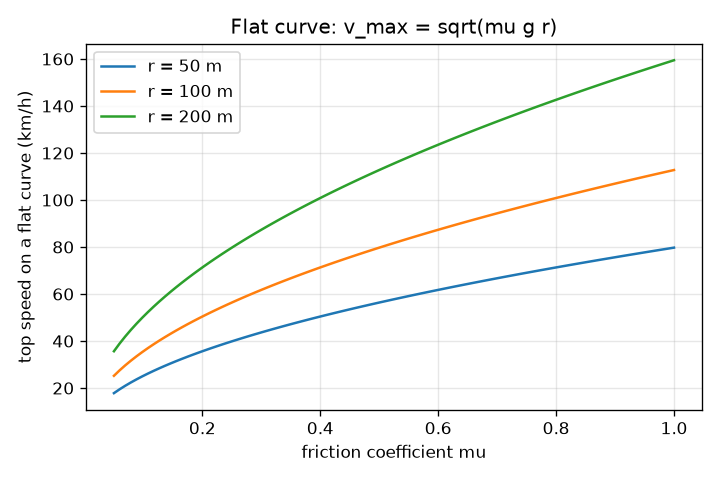
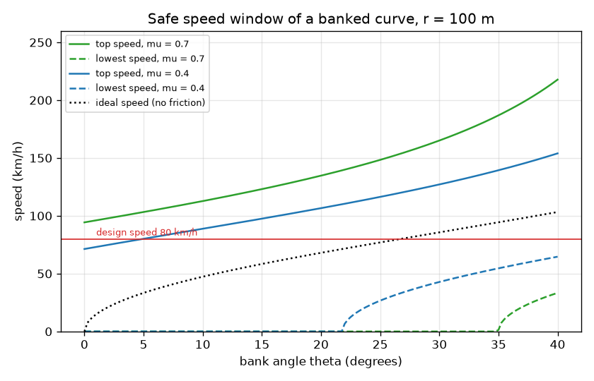

# Session 2: Friction and banking supply the inward force

*Level 2 (mathematical engineering model) · about 75 minutes · opencentripetal*

> This is a simplified educational model. It is not a validated design tool and must not be used for real structures, electrical installations, vehicles, industrial processes or medical decisions.

**Prerequisites**

- Session 1: F = m v^2 / r.
- Sine, cosine and tangent of an angle; resolving a force into parts.

**Learning objectives.** After this session you can:

- Find the top speed on a flat curve from friction, v = sqrt(mu g r).
- Derive the ideal banking angle tan(theta) = v^2 / (g r) from a force diagram.
- Derive and use the safe speed range of a banked curve with friction.
- Choose a bank angle for a design speed and find the limit on a wet road.

## A. Real-world problem
On a flat road the only thing that can push a car sideways is friction between the tyres and the road. It has a limit, and the limit is much lower on a wet road. Engineers therefore tilt (bank) fast curves so that the road itself helps to push the car inward. How fast can a car go round a flat curve of radius 100 m? What bank angle suits a curve of radius 100 m at 80 km/h? And what happens to the safe speeds when the road is wet?

## B. Concept and theory
Flat curve: friction supplies the inward force and cannot exceed mu N = mu m g, so m v^2 / r <= mu m g and the mass cancels: v_max = sqrt(mu g r). Banked curve: tilt the road inward by theta. The normal force N is perpendicular to the road, so it has an inward horizontal part N sin(theta) and an upward part N cos(theta). With no friction, N cos(theta) = m g and N sin(theta) = m v^2 / r, so tan(theta) = v^2 / (g r): the ideal banking angle for speed v. With friction f along the road, at the top speed the car is about to slide up and out, so friction points down the slope with f = mu N; at the lowest speed it is about to slide down and in, so friction points up the slope. Resolving vertically and horizontally and dividing gives v_max^2 = g r (tan(theta) + mu) / (1 - mu tan(theta)) and v_min^2 = g r (tan(theta) - mu) / (1 + mu tan(theta)). If mu >= tan(theta), friction alone can hold a stopped car, so v_min = 0. If mu tan(theta) >= 1, no speed makes the car slide out. The safe range is v_min <= v <= v_max.

| Symbol | Meaning | Unit |
|---|---|---|
| mu | friction coefficient between tyre and road (dry about 0.7, wet about 0.4, ice about 0.1) | no unit |
| g | gravitational acceleration, 9.81 | m/s^2 |
| theta | bank angle of the road, tilted towards the centre | degrees |
| N | normal force from the road, perpendicular to its surface | N |
| f | friction force along the road surface | N |
| v_max, v_min | highest and lowest safe speed | m/s |

**Assumptions**

- The car is a point mass; no tipping over, no weight shift between wheels.
- One constant friction coefficient mu, the same for all directions.
- Circular curve of constant radius r, constant speed.
- Educational model only; real roads are designed to standards with larger margins.

$$ v_{\max}=\sqrt{\mu g r}\quad\text{(flat curve)} $$

$$ N\cos\theta=mg,\quad N\sin\theta=\frac{mv^{2}}{r}\;\Rightarrow\;\tan\theta=\frac{v^{2}}{gr} $$

$$ N\cos\theta-s\mu N\sin\theta=mg,\quad N\sin\theta+s\mu N\cos\theta=\frac{mv^{2}}{r}\quad(s=+1\text{ top speed},\ s=-1\text{ lowest}) $$

$$ v_{\max}^{2}=gr\,\frac{\tan\theta+\mu}{1-\mu\tan\theta},\qquad v_{\min}^{2}=gr\,\frac{\tan\theta-\mu}{1+\mu\tan\theta} $$

## C. Visual explanation
The first figure is a cross-section of the road. The green normal force is perpendicular to the road and tilts towards the centre of the curve (left), the grey weight points down, and the red friction arrow lies along the road. The dashed black arrow is the horizontal inward push m v^2 / r that the three forces must add up to. The second figure plots the safe speed window against bank angle: the red curve is the top speed, the blue curve the lowest speed and the grey curve the ideal speed with no friction, which lies between them. The window opens wider for larger mu, and the blue curve stays at zero until tan(theta) exceeds mu.

*Flat curve: top speed against friction coefficient for three radii.*

*Safe speed window against bank angle for dry and wet roads, radius 100 m, with the 80 km/h design speed.*

## D. Interactive simulation
Run the lesson (`python start.py 2`), then open the live app: [Session 2: flat and banked curves](https://krunalpanchal1995.github.io/opencentripetal/session-02/) (or `app.html` in this folder). Set a speed and watch the arrows in the cross-section: the red friction arrow flips from up the slope to down the slope as you go from slow to fast. Then open the window graph and move the car dot in and out of the band.

**Challenge.** On a wet road with mu 0.3 or less, radius at most 100 m and speed at least 80 km/h, find a bank angle that makes the car safe.

## E. Worked example and experiment
**Problem.** A curve of radius 100 m is designed for 80 km/h. Find the ideal bank angle. Then find the safe speed range on this banked curve when the road is wet with mu = 0.4.

1. Convert: 80 km/h = 80 / 3.6 = 22.22 m/s.
2. tan(theta) = v^2 / (g r) = 22.22^2 / (9.81 * 100) = 493.8 / 981 = 0.5034, so theta = 26.72 degrees.
3. Top speed on the wet road: v_max^2 = 981 * (0.5034 + 0.4) / (1 - 0.4 * 0.5034) = 981 * 0.9034 / 0.7986 = 1109.8, so v_max = 33.31 m/s = 119.9 km/h.
4. Lowest speed: v_min^2 = 981 * (0.5034 - 0.4) / (1 + 0.4 * 0.5034) = 981 * 0.1034 / 1.2014 = 84.4, so v_min = 9.19 m/s = 33.1 km/h.
5. Compare with a flat wet curve: v_max = sqrt(0.4 * 9.81 * 100) = 19.81 m/s = 71.3 km/h. Banking raises the wet limit from 71.3 to 119.9 km/h.

**Answer.** Ideal bank angle 26.72 degrees; on that bank with mu = 0.4 the safe range is 33.1 to 119.9 km/h, against a flat-road wet limit of 71.3 km/h.

**Experiment.** Put a coin on a record player or a turntable at a radius of 0.10 m. First find mu by tilting a board with the same surface until the coin just slides (mu = tan of that angle). Then predict the speed at which the coin slips from omega = sqrt(mu g / r): for mu = 0.5 this is 66.9 revolutions per minute. Compare with what you see. Real coins slip earlier or later because the surface is not uniform, the starting friction differs from the sliding friction, and the turntable is not perfectly level; the model uses a single mu.

## F. Assessment and design challenge
**Question type A: Conceptual.** Why does the mass of the car not appear in v_max = sqrt(mu g r)? Would a heavy truck and a small car have the same limit in this model?

Hint

Write the inward force needed and the largest friction force, and see what happens to m.

Step-by-step solution

The inward force needed is m v^2 / r and the largest friction force is mu m g (N = m g on a flat road). Both are proportional to m, so m cancels and the limit depends only on mu, g and r. In this simple model a truck and a small car with the same tyres and road have the same limit. Real trucks differ because they can tip over, their load shifts and their tyres behave differently, none of which is in the model.

**Question type B: Numerical.** Find the top speed on a flat wet curve (mu = 0.4) of radius 60 m, in m/s and km/h.

Hint

v = sqrt(mu g r).

Step-by-step solution

v = sqrt(0.4 * 9.81 * 60) = sqrt(235.4) = 15.34 m/s. In km/h: 15.34 * 3.6 = 55.2 km/h. Sanity check: the 100 m curve gives 71.3 km/h and the speed goes with the square root of the radius, so the 60 m curve should give 71.3 * sqrt(0.6) = 55.2 km/h. It does.

**Question type C: Graph and simulation interpretation.** On the safe-speed window graph for mu = 0.4, at what bank angle does the lowest-speed curve leave zero? What does a nonzero lowest speed mean for a slow vehicle?

Hint

The lowest speed is zero while friction alone can hold a stopped car: mu >= tan(theta).

Step-by-step solution

The curve leaves zero where tan(theta) = mu = 0.4, that is theta = 21.8 degrees. Above this angle a stopped or slow vehicle slides down the bank towards the inside of the curve, because gravity along the slope exceeds the friction that the road can give. On the same graph with mu = 0.7 the angle is 35.0 degrees.

**Question type D: Design and optimisation challenge.** Design: a curve of radius 100 m has a design speed of 80 km/h and must stay safe on a wet road with mu = 0.3. Choose a bank angle. What happens if you simply use the ideal angle 26.7 degrees?

Hint

The smallest angle that keeps 80 km/h at or below the top speed is tan(theta) = (k - mu) / (1 + mu k) with k = v^2 / (g r). Then compute the lowest speed for the steeper angle.

Step-by-step solution

k = 0.5034, so tan(theta) = (0.5034 - 0.3) / (1 + 0.3 * 0.5034) = 0.1767 and theta = 10.02 degrees; a bank of 10 degrees gives a wet top speed of 79.96 km/h, just below 80, so choose 12 degrees (top speed 83.4 km/h) or 15 degrees (88.6 km/h) for a margin. With the ideal angle 26.7 degrees the wet top speed is 109.7 km/h but the lowest speed becomes 47.4 km/h, so slow traffic or a stopped car on a wet or icy road would slide inward. Trade-off: a steeper bank raises the top speed but also raises the lowest safe speed. Assumptions: one mu, point-mass car, no margin for tipping.

Score yourself with [RUBRIC.md](../../RUBRIC.md). Print the [activity sheet](activity_sheet.md) to work on paper.

## Common misconceptions
| Common misconception | What is actually true |
|---|---|
| The ideal bank angle depends on the mass of the car. | tan(theta) = v^2 / (g r): mass cancels. Heavy and light cars have the same ideal angle. |
| A banked curve works only at one speed. | Only the frictionless ideal works at exactly one speed. With friction there is a whole safe range from v_min to v_max. |
| Friction on a banked curve always points down the slope. | At the top speed it points down the slope (the car is about to slide out); at the lowest speed it points up the slope; at the ideal speed it is zero. |
| The normal force equals m g on a banked curve. | N = m g / cos(theta) in the frictionless case, and larger when friction acts or at higher speed; it equals m g only on a flat road. |

## Glossary
- **bank angle**: the tilt of the road surface towards the inside of the curve
- **normal force**: the push of a surface on an object, perpendicular to the surface
- **friction coefficient (mu)**: ratio of the largest friction force to the normal force
- **ideal speed**: the speed at which a banked curve needs no friction at all

## Finish
1. Do the three coding tasks in [exercises.md](exercises.md).
2. Run `python start.py 2` again after your changes. It ends with the checkpoint; when it prints `PASS`, you are done. (Checkpoint only: `python start.py check 2`.)

Next: [Session 3](../session-03/README.md)
