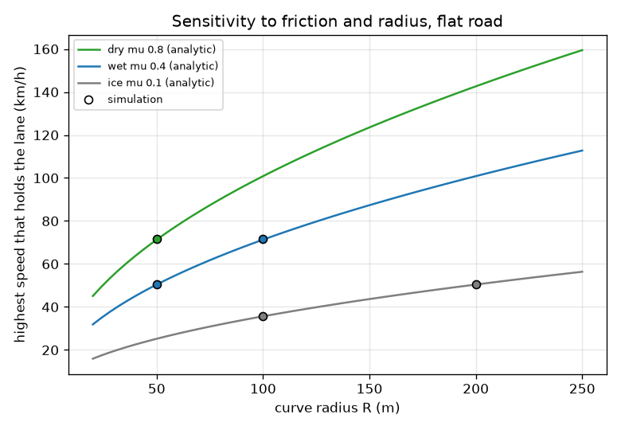
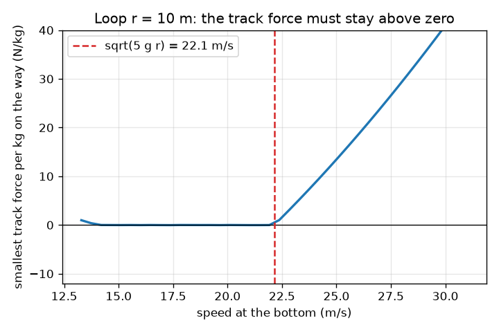
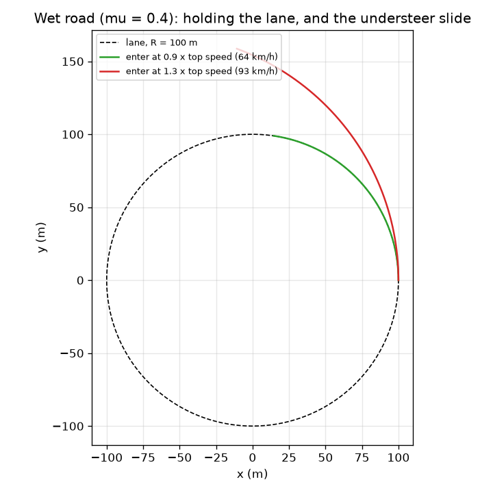

# Session 3: A simulated car on a curve, checked against the formulas

*Level 3 (simulation and validation) · about 90 minutes · opencentripetal*

> This is a simplified educational model. It is not a validated design tool and must not be used for real structures, electrical installations, vehicles, industrial processes or medical decisions.

**Prerequisites**

- Session 1: F = m v^2 / r.
- Session 2: friction limit, banking and the safe speed range.

**Learning objectives.** After this session you can:

- Build a time-stepping simulation of a car whose tyre force is limited by a friction circle.
- Validate it against the analytic limits (flat, banked, with and without friction) and against energy conservation.
- Explain the effect of braking or accelerating in a bend, and of dry, wet and icy roads, using the simulation.
- Reproduce the minimum speed at the top of a roller-coaster loop, sqrt(g r), and set a speed limit with a safety margin.

## A. Real-world problem
Session 2 gave formulas for the limit speed. But what really happens when a driver arrives too fast, brakes in the middle of the bend, or the road turns wet? A simulation can show the slide itself. We only trust it after it reproduces the formulas we derived and obeys energy and momentum rules. Then we can ask the engineering question: what speed limit should the sign say, with a margin for safety?

## B. Concept and theory
The simulation treats the car as a point mass on a road surface tilted inward by theta. State: horizontal position and velocity. Each step the normal force N follows from keeping the car on the surface, N = g cos(theta) + (v_phi^2 / rho) sin(theta) per unit mass. The driver asks the tyres for a force along the heading (braking or accelerating, a_long) and a sideways force to follow the lane circle of radius R, with a small steering correction when the car drifts. The friction circle limits the total tyre force: if sqrt(F_side^2 + F_long^2) is larger than mu N, both parts are scaled down together, so braking costs cornering grip and the car runs wide (understeer). The equations are advanced in time with the fourth-order Runge-Kutta method. Validation references: the limiting speeds of Session 2; with braking or accelerating by a on a flat road, the lateral share of the friction circle is sqrt((mu g)^2 - a^2), so the slide speed becomes sqrt(R sqrt((mu g)^2 - a^2)); a car sliding with saturated friction and no braking keeps its speed and follows a circle of radius v^2 / (mu g); with no friction, kinetic plus potential energy is conserved. A roller-coaster loop of radius r: at the top, N + m g = m v^2 / r and N >= 0, so v_top >= sqrt(g r) and, by energy conservation over a height gain 2 r, v_bottom >= sqrt(5 g r).

| Symbol | Meaning | Unit |
|---|---|---|
| R | radius of the lane circle | m |
| rho | actual distance of the car from the centre | m |
| mu | friction coefficient (dry 0.8, wet 0.4, ice 0.1 are typical round numbers) | no unit |
| a_long | braking (negative) or accelerating (positive) acceleration | m/s^2 |
| dt | time step of the simulation | s |
| ratio | tyre force asked divided by the friction limit mu N; above 1 the car slides | no unit |
| margin | factor below the wet limit used for a speed limit sign | no unit |

**Assumptions**

- Point-mass car with one constant mu; no weight transfer, no tyre slip angle, no tipping.
- A slide means drifting more than 1.0 m from the lane within 20 s.
- Friction while sliding is taken equal to the limit mu N in the direction the driver asks (a simple friction-circle model).
- Educational model only; not a road design tool.

$$ N=g\cos\theta+\frac{v_\varphi^{2}}{\rho}\sin\theta,\qquad \sqrt{F_{\mathrm{side}}^{2}+F_{\mathrm{long}}^{2}}\le \mu N\quad\text{(friction circle)} $$

$$ v_{\mathrm{slide}}(a)=\sqrt{R\sqrt{(\mu g)^{2}-a^{2}}}\quad\text{(flat road, braking or accelerating by }a) $$

$$ r_{\mathrm{skid}}=\frac{v^{2}}{\mu g}\quad\text{(radius of the path of a sliding car)} $$

$$ E=\tfrac12 v^{2}+g z=\text{constant (no friction)},\qquad v_{\mathrm{top}}\ge\sqrt{g r},\quad v_{\mathrm{bottom}}\ge\sqrt{5 g r} $$

## C. Visual explanation
The first figure shows two cars entering the wet curve (mu 0.4, R = 100 m). The green car enters at 0.9 of the limit and follows the lane; the red car enters at 1.3 of the limit and runs wide along a larger circle: the understeer slide. The second figure plots the highest speed that holds the lane against radius for dry, wet and ice roads, as lines from the formula and dots from the simulation; the dots sit on the lines. The third figure plots the smallest track force of a roller-coaster loop of radius 10 m against the speed at the bottom; it crosses zero at sqrt(5 g r) = 22.1 m/s.

*Highest speed that holds the lane against radius for dry, wet and ice roads: formula (lines) and simulation (dots).*

*Roller-coaster loop of radius 10 m: the smallest track force crosses zero at sqrt(5 g r) = 22.1 m/s.*

*Top view: the car entering at 0.9 of the limit holds the lane; entering at 1.3 times the limit it follows a wide circle.*

## D. Interactive simulation
Run the lesson (`python start.py 3`), then open the live app: [Session 3: the friction circle and the grip limit](https://krunalpanchal1995.github.io/opencentripetal/session-03/) (or `app.html` in this folder). Open the friction circle view: the dot is what the driver asks of the tyres. Slide the speed up until the dot leaves the circle, then add braking and see how much sooner it leaves. Open the radius view and compare dry, wet and ice.

**Challenge.** On a road with mu 0.4 or less, radius at most 60 m, find a bank angle at which a car braking at 2 m/s^2 or more still grips at 70 km/h or more.

## E. Worked example and experiment
**Problem.** For a flat wet curve (mu = 0.4, R = 100 m) predict the top speed by hand, then find it with the simulation, and decide whether the simulation is trustworthy. Then predict where a car entering 30 percent too fast ends up after 6 s.

1. Hand calculation: v = sqrt(mu g R) = sqrt(0.4 * 9.81 * 100) = 19.81 m/s = 71.3 km/h.
2. Simulation: `sim_limit(100, 0.4, 0.0, 'max')` bisects on the start speed and gives 71.5 km/h, 0.3 percent above the formula. The small excess is because a slide that begins just above the limit takes time to grow to 1 m.
3. Banked check: for a 30 degree bank with mu = 0.3 the simulation gives 54.0 to 116.7 km/h against 54.8 to 116.2 km/h from Session 2: within 2 percent.
4. Energy check: with mu = 0 on a 20 degree bank the energy per kg stays constant to better than 1e-13 (relative), so the integrator does not create or destroy energy.
5. Failure case: entering at 1.3 times the limit, 92.7 km/h = 25.75 m/s, the car slides on a circle of radius v^2 / (mu g) = 25.75^2 / 3.924 = 169.0 m. After 6 s it is at (34.2, 133.9) m in the simulation and at (34.2, 133.9) m on the analytic circle: 138.2 m from the centre, far outside a lane of radius 100 m.

**Answer.** Hand 71.3 km/h, simulation 71.5 km/h (within 0.3 percent); the car entering at 1.3 times the limit slides on a circle of radius 169 m and is 138 m from the centre after 6 s.

**Experiment.** Roll a marble or toy car round a banked plastic track (or tilt a tray) and find the speed at which it leaves the track; compare with sqrt(g r tan(theta)) for a ball with almost no friction, and then with a rough surface. The measured speed will differ because a rolling marble has spin energy, because the real friction depends on speed and surface, and because a real track is never a perfect circle. The model is a point mass with one mu; the lesson is that a validated simplified model predicts trends well, and absolute values only roughly.

## Real-world application and mini-project: Set the speed limit sign for a curve
A council asks you to choose the speed limit sign for a curve of radius 80 m, banked at 4 degrees, whose wet surface has a friction coefficient of 0.35. The sign must leave a safety margin on the wet limit and be a multiple of 5 km/h. Use `analytic_limits`, `posted_speed_limit` and `holds` from Session 3, compare margins of 0.6, 0.7, 0.75, 0.8 and 0.9, and check each sign speed in the simulation on a wet road and on ice (mu 0.1).

**Deliverable:** A script that prints, for each margin, the wet top speed, the sign value, and whether the simulated car holds the lane at the sign speed on wet road and on ice, then names your recommended margin and explains the trade-off in two sentences. This is a teaching exercise, not a real traffic-engineering standard.

**Success looks like:** The wet top speed is reported as 66.2 km/h and the signs come out as 35, 45, 45, 50 and 55 km/h for margins 0.6, 0.7, 0.75, 0.8 and 0.9. The 45 km/h sign holds on wet road but slides on ice, and your write-up says so.

## F. Assessment and design challenge
**Question type A: Conceptual.** Why does braking in the middle of a bend make a slide more likely, even though braking reduces the speed?

Hint

Think of the friction circle: the tyre force has a fixed budget mu N to share between braking and cornering.

Step-by-step solution

The tyres can give a total force of at most mu N. Braking uses part of that budget, so less is left for the sideways force. For a car at the lane circle the sideways demand is v^2 / R, which falls only as the speed falls. At the moment the driver brakes, the demand is the full sideways demand plus the braking demand: the total can exceed mu N. In the simulation a car entering at 0.9 of the limit has a demand ratio of 0.81 when coasting but 1.11 when braking at 3 m/s^2. Brake before the bend, not in it.

**Question type B: Numerical.** A road with mu = 0.4 has a flat curve of radius 100 m. Find the speed at which a car accelerating at 2 m/s^2 loses grip. Compare with the speed without acceleration.

Hint

v_slide = sqrt(R * sqrt((mu g)^2 - a^2)).

Step-by-step solution

mu g = 0.4 * 9.81 = 3.924 m/s^2. (mu g)^2 = 15.40, a^2 = 4, difference 11.40, square root 3.376 m/s^2 (the lateral budget). v = sqrt(100 * 3.376) = 18.37 m/s = 66.1 km/h. Without acceleration the limit is 71.3 km/h, so accelerating at 2 m/s^2 lowers the limit by about 5 km/h. The simulation gives 66.2 km/h.

**Question type C: Graph and simulation interpretation.** In the radius graph, the dry, wet and ice lines are curves that rise with radius. By what factor does the limit change if the radius is multiplied by 4, and if mu is divided by 4 (wet to ice)?

Hint

The limit is sqrt(mu g R).

Step-by-step solution

The limit is proportional to the square root of R and to the square root of mu. Four times the radius doubles the limit; a quarter of the friction halves it. So a wet road (0.4) that goes to ice (0.1) loses half of its limit speed: from 71.3 to 35.7 km/h at R = 100 m. The dots from the simulation follow the same lines.

**Question type D: Design and optimisation challenge.** Design: a loop of a roller coaster has radius 10 m. What minimum speed is needed at the top and at the bottom? Choose a design speed at the bottom with a 10 percent margin and say what the passengers feel at the top.

Hint

v_top = sqrt(g r); energy: v_bottom^2 = v_top^2 + 4 g r.

Step-by-step solution

v_top = sqrt(9.81 * 10) = 9.90 m/s; v_bottom = sqrt(5 * 9.81 * 10) = 22.15 m/s (79.7 km/h). With a 10 percent margin on the bottom speed: 24.4 m/s. The margin makes the top speed sqrt(24.4^2 - 4 * 98.1) = 14.2 m/s, with N = m (v^2 / r - g) = m * (20.15 - 9.81) = 10.3 m, about 1.05 times the weight: passengers feel pressed into their seats with about 1.05 times their body weight. Assumptions: no friction or air drag, a point mass, and a perfect circle (real loops are not circular because the force would jump).

Score yourself with [RUBRIC.md](../../RUBRIC.md). Print the [activity sheet](activity_sheet.md) to work on paper.

## Common misconceptions
| Common misconception | What is actually true |
|---|---|
| A validated simulation proves the real car will behave the same. | It proves the code solves the model correctly. The model itself (one mu, a point mass) is a simplification; reality adds weight transfer, tyre slip and tipping. |
| At the top of a loop gravity is cancelled, so the rider is weightless. | Gravity still acts. The rider feels weightless only when the track force is zero, which happens exactly at the minimum speed sqrt(g r); faster than that the track pushes the cart down onto the rail. |
| Once the car slides, friction disappears. | In this model the friction stays at the limit mu N; the car slides because the demand is larger than that limit, and it follows a wider circle. |
| A smaller time step always changes the result a lot. | A good integrator converges: halving dt should change the end point only slightly, which the checkpoint tests. |

## Glossary
- **friction circle**: the set of tyre forces (braking, accelerating and sideways) that a tyre can give: a circle of radius mu N
- **understeer**: running wide in a bend because the front tyres cannot give the sideways force asked
- **Runge-Kutta**: a time-stepping method that uses four slope estimates per step for high accuracy
- **bisection**: finding a threshold by repeatedly halving an interval between a value that works and one that does not
- **safety margin**: a factor that keeps the working value below the calculated limit

## Finish
1. Do the three coding tasks in [exercises.md](exercises.md).
2. Run `python start.py 3` again after your changes. It ends with the checkpoint; when it prints `PASS`, you are done. (Checkpoint only: `python start.py check 3`.)

Next: the [roadmap](../../promo/roadmap.md). Session 4 is yours to build.
